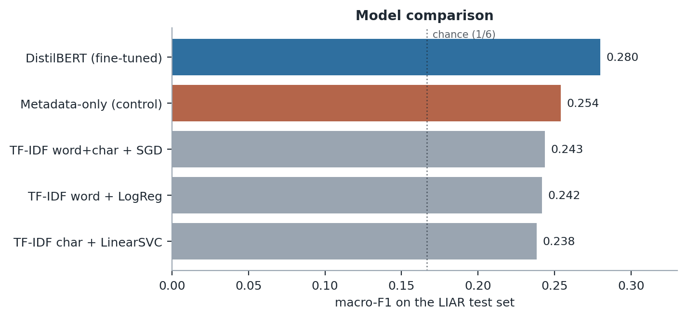
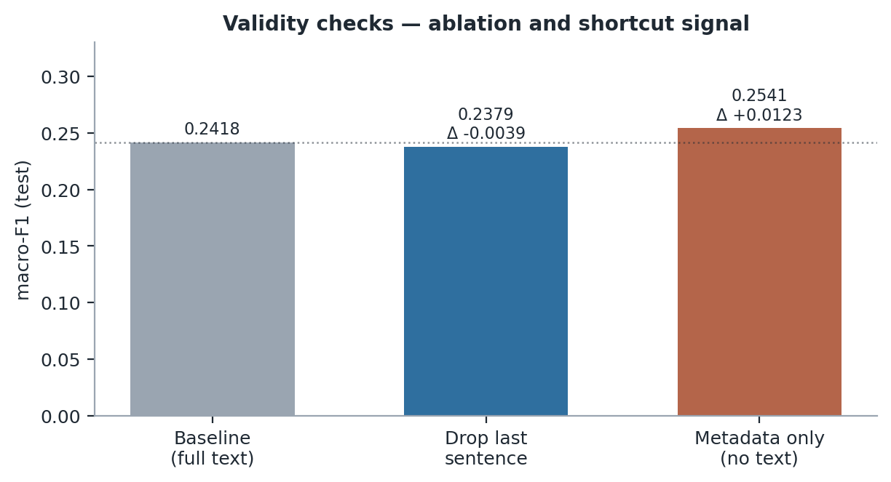
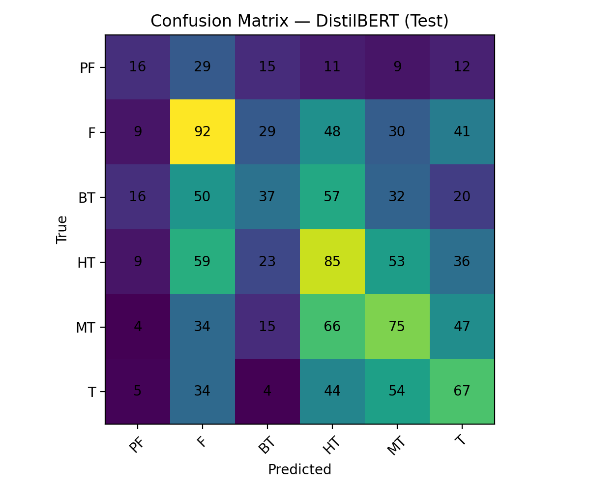
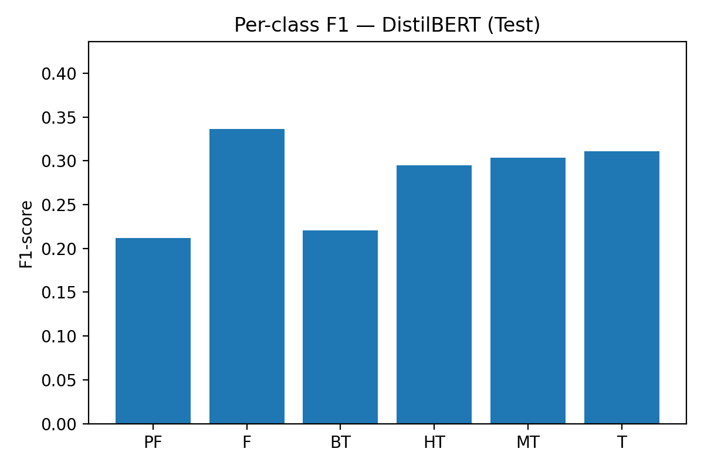
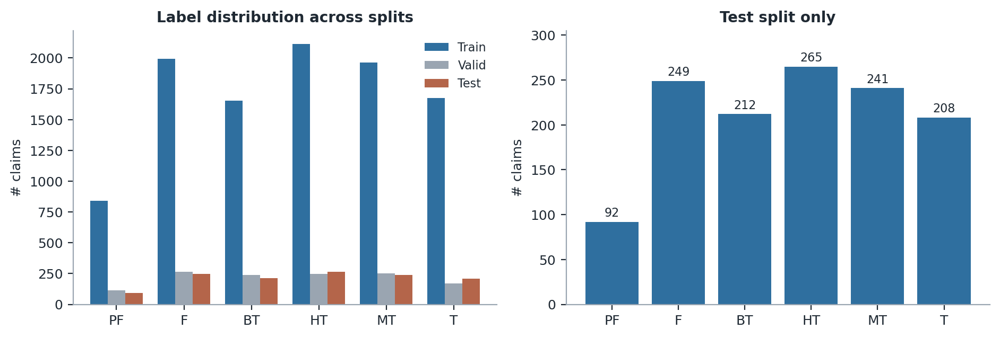
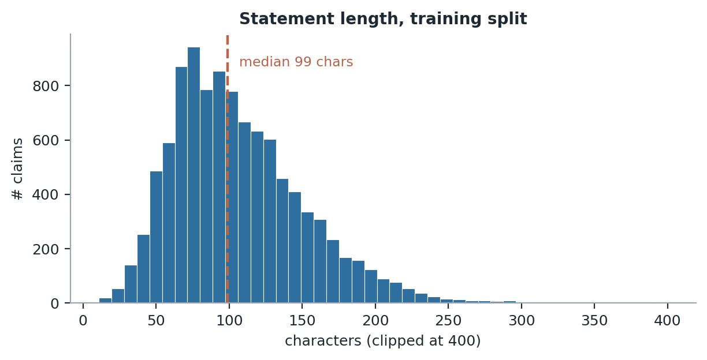

# Fake News Detection on LIAR

**Six-way truthfulness classification of short political claims — and a control experiment that calls the whole task into question.**

[](https://github.com/aleksandarnn/fake-news-detection-group2/actions/workflows/reproduce.yml)
[](https://www.python.org/)
[](https://scikit-learn.org/)
[](https://pytorch.org/)
[](LICENSE)

We fine-tuned DistilBERT on the [LIAR dataset](https://aclanthology.org/P17-2067/) and reached **0.294 test accuracy** — above the **0.274** reported by the model that introduced the benchmark.

Then we ran a control that never sees the claim at all. A classifier given only the speaker's name, party, state and job — no statement text whatsoever — **beat every text-based model we trained.**

That gap is the real result of this project.

---

## Results

All numbers are on the untouched LIAR test split. **Macro-F1 is the headline metric**, because the six classes are imbalanced: `pants-fire` has roughly a third of the support of `half-true`, so plain accuracy would reward a model for quietly ignoring the rare classes.

| Model | Input | macro-F1 | Accuracy |
|---|---|---:|---:|
| **DistilBERT** (fine-tuned) | statement text | **0.280** | **0.294** |
| ⚠️ **Metadata-only** (control) | speaker, party, state, subject, job, context — **no text** | 0.254 | 0.252 |
| TF-IDF (word 1–2 + char 3–6) + SGD | statement text | 0.243 | 0.253 |
| TF-IDF (word 1–2) + Logistic Regression | statement text | 0.242 | 0.243 |
| TF-IDF (char 3–6) + LinearSVC | statement text | 0.238 | 0.246 |

<p align="center">
  
</p>

### How that compares to the literature

LIAR is a genuinely hard benchmark, and the absolute numbers look low out of context. Here is where they sit against Table 2 of Wang (2017), the paper that released the dataset:

| Model | Test accuracy |
|---|---:|
| Majority class | 0.208 |
| Bi-LSTM | 0.233 |
| Logistic Regression | 0.247 |
| SVM | 0.255 |
| CNN (text only) | 0.270 |
| Hybrid CNN (text + **all** metadata) | 0.274 |
| **This repo — DistilBERT (text only)** | **0.294** |

Our linear baselines land within a point of the paper's linear baselines, which is the expected result and a useful sanity check that the pipeline is sound. The DistilBERT run clears the paper's best model using text alone.

> **Caveat, stated plainly:** the widely circulated copy of LIAR we use drops a handful of malformed rows, so our splits are 10,240 / 1,284 / 1,267 against the paper's 10,269 / 1,284 / 1,283. This is a close comparison, not an exact one.

---

## The finding: the dataset leaks

Two diagnostics, both run against the logistic-regression baseline so that only the *input* changes.

<p align="center">
  
</p>

**1. Last-sentence ablation (Δ −0.0039).** We strip the final sentence from every claim, in training *and* test, then retrain. If a model were keying on dramatic closing phrases, performance would collapse. It barely moves. The model is reading the whole claim, not a shortcut at the end.

**2. Metadata-only control (Δ +0.0123).** We feed the same classifier only the non-textual fields — who said it, their party, their state, their job — and blank the statement entirely. It scores **higher than every text model we trained.**

The second result is the one worth sitting with. It means a chunk of what looks like "fake news detection" on this benchmark is really *speaker identification*. Knowing that a given politician has a history of false claims predicts the label better than reading what they actually said this time. Any LIAR result that feeds metadata into the model — including the hybrid models in the original paper — is partly measuring that prior, not linguistic deception.

This is why every headline model in this repo is **text-only**. The metadata model exists purely as a control, and it is reported as a warning rather than a result.

---

## Where the models fail

<p align="center">
  
  
</p>

Errors are not random — they cluster next to the diagonal. The model confuses `half-true` with `mostly-true` constantly, while separating `pants-fire` from `true` far more reliably.

That pattern says the six labels are really a **blurred ordinal scale**, not six clean categories. The boundary between "half-true" and "mostly-true" is a human judgement call that even the original fact-checkers would not reproduce perfectly. Treating the task as flat 6-way classification throws that structure away and charges the model full price for a one-step miss.

---

## The data

<p align="center">
  
</p>

| Split | Claims |
|---|---:|
| Train | 10,240 |
| Validation | 1,284 |
| Test | 1,267 |

Labels, ordered — the integer id *is* the position, which is what makes the confusion matrix readable:

`pants-fire (0)` → `false (1)` → `barely-true (2)` → `half-true (3)` → `mostly-true (4)` → `true (5)`

<p align="center">
  
</p>

**Claims are short: a median of 99 characters.** That single fact drives most of the design. There is very little text to work with per example, which is why character n-grams are worth trying at all, why `max_len=128` is more than enough for the transformer, and why the task is hard in the first place — you are judging a one-sentence claim with no evidence, no source document and no world knowledge.

---

## Quickstart

```bash
git clone https://github.com/aleksandarnn/fake-news-detection-group2.git
cd fake-news-detection-group2
python -m venv .venv && source .venv/bin/activate   # Windows: .venv\Scripts\activate
pip install -r requirements.txt
```

The LIAR splits are committed, so there is nothing to download. Reproduce every linear result in about a minute:

```bash
python -m src.baselines --quick
```

| Command | What it does | Runtime |
|---|---|---|
| `python -m src.data` | Print split sizes, label counts and length stats | instant |
| `python -m src.baselines --quick` | All four models + both diagnostics, using the recorded best hyper-parameters | ~15 s |
| `python -m src.baselines` | The same, but re-running the full grid searches | 20–40 min |
| `python -m src.baselines --only logreg metadata --report` | A subset, with per-class precision/recall/F1 | ~5 s |
| `python -m src.figures` | Rebuild every figure from the tracked metrics | ~3 s |
| `python -m tests.check_metrics` | Verify the results still match this README | ~2 s |

Metrics land in `experiments/*.json` and are collected into `experiments/liar_models_summary.csv`.

Trained models are **not** committed — they are ~45 MB of `.joblib` that reproduce exactly from the scripts. Pass `--save-models` if you want them on disk.

### The transformer

`torch` is a large install and nothing except `src/distilbert.py` imports it, so it lives in a separate requirements file:

```bash
pip install -r requirements-dl.txt
python -m src.distilbert          # ~5 min on GPU, ~1 h on CPU
```

### Continuous integration

Every push re-runs all four linear models and both diagnostics from scratch on Python 3.10 and 3.12, then checks each metric against the numbers in this README — including the claim that the metadata-only control still outscores every text model. If a dependency bump moves a result, the build goes red. That check is [`tests/check_metrics.py`](tests/check_metrics.py).

---

## Repository layout

```
.
├── src/
│   ├── data.py              # LIAR loading, label mapping, text transforms
│   ├── baselines.py         # TF-IDF + linear models, ablation, metadata control
│   ├── distilbert.py        # DistilBERT fine-tuning (plain PyTorch loop)
│   └── figures.py           # regenerates every figure from tracked artifacts
├── tests/check_metrics.py   # fails if any result drifts from this README
├── .github/workflows/       # CI: re-runs the experiments on every push
├── data/LIAR_dataset/       # the official train/valid/test splits (committed, 3 MB)
├── experiments/             # metrics JSON + the summary CSV
├── figures/                 # all plots used in this README and the report
├── NLP_Project.ipynb        # the original exploratory notebook
├── NLP_project.pdf          # the full written report
├── requirements.txt         # core: pandas, scikit-learn, matplotlib
└── requirements-dl.txt      # torch + transformers, for the DistilBERT run
```

The notebook is kept as the record of how the work actually happened. **`src/` is the clean path** — it is what you should read, and what produces the numbers above.

---

## Method

**Preprocessing is deliberately minimal.** Lowercasing by the vectorizer, nothing else — no stop-word removal, no stemming, no lemmatisation. Every cleaning step is a chance to delete the signal you are trying to measure, and on 99-character claims there is not much to spare.

**Linear baselines.** Three TF-IDF configurations, each tuned by grid search on macro-F1 with 3- or 5-fold cross-validation:

- **word 1–2 grams → Logistic Regression** (`class_weight="balanced"`). The transparent baseline: every coefficient maps back to a readable n-gram.
- **char 3–6 grams → LinearSVC.** Character n-grams survive typos and odd tokenisation, which matters on quote-heavy political text.
- **word + char via `FeatureUnion` → SGD (hinge loss).** Tests whether the two views are complementary. They are not — the combination adds essentially nothing, meaning both are capturing the same lexical signal.

**Transformer.** `distilbert-base-uncased`, 3 epochs, lr 2e-5 with linear warmup over 10% of steps, AdamW, gradient clipping at 1.0, `max_len=128`, dynamic per-batch padding. The checkpoint is selected by **validation** macro-F1, so the test split is touched exactly once.

**Both diagnostics reuse the logistic-regression pipeline unchanged**, so the only variable between a diagnostic and the baseline is the input text. That is the whole point of a control.

---

## Reproducibility notes

Running `python -m src.baselines --quick` today reproduces four of the five original results **exactly**, including the ablation figure:

| Model | Original run | Reproduced | |
|---|---:|---:|---|
| TF-IDF word + LogReg | 0.2418 | 0.2418 | ✅ exact |
| TF-IDF char + LinearSVC | 0.2383 | 0.2383 | ✅ exact |
| Metadata-only | 0.2541 | 0.2541 | ✅ exact |
| Drop-last-sentence ablation | 0.2379 | 0.2379 | ✅ exact |
| TF-IDF word+char + SGD | 0.2362 | 0.2435 | ⚠️ +0.0073 |

The SGD model drifts under a newer scikit-learn. `SGDClassifier` with hinge loss is sensitive to version-level changes in sample shuffling and the convergence check, and a seed does not pin behaviour across library versions. The configuration is identical; only the library moved. The table above reports the **reproduced** value, since that is what this code produces today.

Two further honest notes:

- **`NLP_project.pdf` reports DistilBERT at macro-F1 0.31 / accuracy 0.32.** The saved artifact in `experiments/bert_liar_plain/metrics.json` says **0.280 / 0.294**. This README uses the artifact numbers throughout, because those are the ones anyone can verify.
- Earlier commits of this repository tracked ~160 MB of model binaries and an unused news corpus. These are now gitignored and reproducible from `src/`. They remain in the git history, so a full `git clone` still downloads them; `git clone --depth 1` does not.

---

## Limitations

- **No evidence, no retrieval.** The model judges a claim in isolation. Real fact-checking means looking something up; nothing here can.
- **The labels are subjective and ordinal.** A flat 6-way loss treats a `half-true` → `mostly-true` miss as exactly as bad as `true` → `pants-fire`. An ordinal objective would almost certainly do better.
- **The dataset leaks speaker identity**, as the control above demonstrates. Any result on LIAR that includes metadata should be read with that in mind.
- **DistilBERT was fine-tuned under tight compute**, 3 epochs at 128 tokens. A larger encoder and a proper sweep would likely add a point or two.

## Further work

Ordinal regression over the six levels rather than flat classification; evidence retrieval against a fact-check corpus; a speaker-disjoint split, so no politician appears in both train and test, which would measure how much of the score survives once the speaker prior is removed; and attribution methods (LIME, SHAP) over the linear models, which are interpretable enough to make that worthwhile.

---

## Citation

The dataset:

```bibtex
@inproceedings{wang2017liar,
  title     = {``Liar, Liar Pants on Fire'': A New Benchmark Dataset for Fake News Detection},
  author    = {Wang, William Yang},
  booktitle = {Proceedings of the 55th Annual Meeting of the Association for
               Computational Linguistics (Volume 2: Short Papers)},
  pages     = {422--426},
  year      = {2017},
  address   = {Vancouver, Canada},
  publisher = {Association for Computational Linguistics},
  doi       = {10.18653/v1/P17-2067}
}
```

Also referenced: [DistilBERT](https://arxiv.org/abs/1910.01108) (Sanh et al., 2019) and [BERT](https://aclanthology.org/N19-1423/) (Devlin et al., 2019).

---

## Authors

**Aleksandar Nikolov** ([@aleksandarnn](https://github.com/aleksandarnn)) · **Jump Srinualnad**
University of Twente — Group 2

The full write-up, including the complete methodology and discussion, is in [`NLP_project.pdf`](NLP_project.pdf).

## License

Code is [MIT](LICENSE). The LIAR dataset remains under its original terms and is redistributed here for academic reproducibility.
